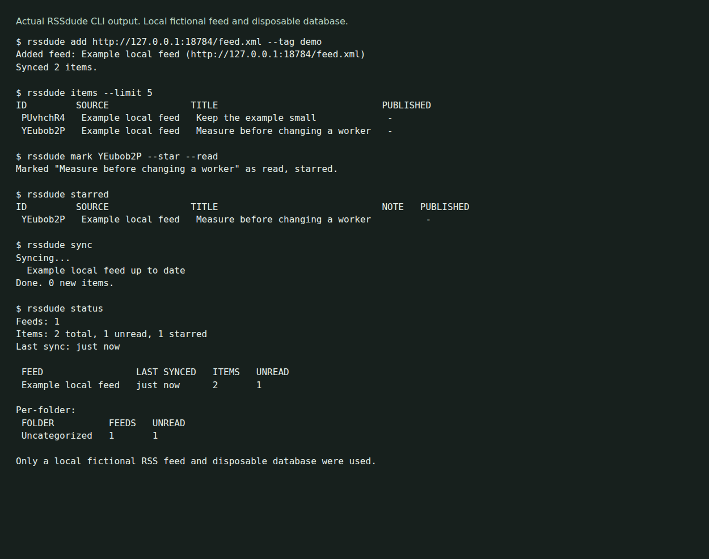

# rssdude

An RSS reader with a terminal UI, scripting commands and an optional HTTP server for a shared database. Feeds, items, read/star marks and notes are stored in a local redb file unless the client is configured to use a server.



The capture uses a loopback RSS fixture and a disposable database. It verifies two items, read/star persistence and a repeat sync without duplicates. [Reproduce it](docs/demo/README.md).

## Build from source

Use Rust with Cargo and Git:

```sh
git clone https://github.com/olegpustovit/rssdude.git
cd rssdude
cargo build --locked
./target/debug/rssdude --help
```

The locked build and 25 existing tests passed on Linux aarch64. On macOS, the Makefile adds the Homebrew libiconv path; see [installation](book/src/install.md). macOS and Homebrew installation were not tested here.

## Read feeds

```sh
./target/debug/rssdude add https://hnrss.org/frontpage --tag tech
./target/debug/rssdude sync
./target/debug/rssdude items --unread --limit 10
./target/debug/rssdude
```

Adding or syncing a feed makes network requests to that URL. Reading full articles can make further requests. The example public feed above was not contacted during this capture. The no-argument command opens the TUI; the new capture exercises the CLI, while existing tests include TUI snapshots.

Most scripting commands support the global `--json` flag:

```sh
./target/debug/rssdude items --unread --json
./target/debug/rssdude search "worker"
./target/debug/rssdude status
```

## Storage and server routing

By default the database is `~/.rssdude/rssdude.redb` and configuration is `~/.rssdude/config.toml`. `RSSDUDE_DB_PATH` changes the database path, but does not disable server routing. A configured server address or reachable `~/.rssdude/server.run` can route commands to a server instead. Check those before using an isolated database.

Server mode is HTTP with optional bearer-token authentication. It does not provide a blanket privacy or security guarantee. [Server setup](book/src/server/setup.md) explains binding and authentication. No server deployment was tested here.

Close database users before copying a backup. [Storage and backup](book/src/storage.md) covers the paths, restore procedure and limits. No forward-compatibility or live-file-copy guarantee is established by this review.

## More detail

- [Local fixture and capture](docs/demo/README.md)
- [Quick start](book/src/quickstart.md)
- [CLI reference](book/src/cli/reference.md)
- [TUI keys](book/src/tui/keybindings.md)
- [Configuration](book/src/config.md)
- [Contributor guide](AGENTS.md)

The previous README declared MIT, but this checkout has no standalone license file or package license declaration. Confirm the intended license before redistribution.
